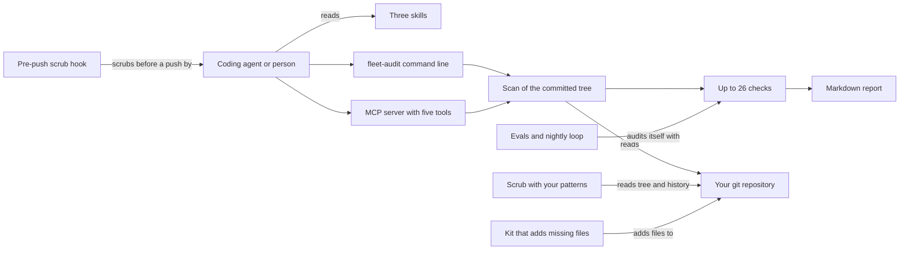

# How Fleet Audit works

Fleet Audit finds out what a coding agent will find in your repository, and what it will miss. It checks a repository against one standard for agent-native projects, which are repositories built for agents to install, read and extend. It scrubs a repository for private text before it goes public, and it writes the standard files that are missing. It is for anyone who publishes repositories that agents are meant to use.

## The parts



An agent reaches Fleet Audit through its [skills](../skills/), its command line or its MCP server. MCP (Model Context Protocol) is a standard way for an agent to call tools. The command line lives in [src/fleet_audit/cli.py](../src/fleet_audit/cli.py). The MCP server in [src/fleet_audit/mcp_server.py](../src/fleet_audit/mcp_server.py) offers five tools. Four only read, and `fleet_kit` writes only when called with `write: true`.

[src/fleet_audit/scan.py](../src/fleet_audit/scan.py) reads the committed tree through git, with helpers in [src/fleet_audit/gitutil.py](../src/fleet_audit/gitutil.py). [src/fleet_audit/checks.py](../src/fleet_audit/checks.py) turns the scan into checks, and [src/fleet_audit/report.py](../src/fleet_audit/report.py) writes them as Markdown. [src/fleet_audit/scrub.py](../src/fleet_audit/scrub.py) runs your patterns, and [src/fleet_audit/history.py](../src/fleet_audit/history.py) rewrites a scratch copy of the history. [src/fleet_audit/kit.py](../src/fleet_audit/kit.py) writes missing files from [src/fleet_audit/templates.py](../src/fleet_audit/templates.py) and README blocks from [src/fleet_audit/blocks.py](../src/fleet_audit/blocks.py). The hook in [hooks/prepush_scrub_hook.py](../hooks/prepush_scrub_hook.py) blocks a `git push` when a pattern matches.

## What happens when you run it

The main flow is `fleet-audit check . --offline`.

1. [src/fleet_audit/cli.py](../src/fleet_audit/cli.py) reads the arguments and runs the `check` branch.
2. `scan_clone` in [src/fleet_audit/scan.py](../src/fleet_audit/scan.py) picks a git ref: the remote's default branch, or the local HEAD with `--head`. Uncommitted files do not count.
3. The scan lists the tree with `git ls-tree` and records the agent surfaces, the identity and memory files, the hygiene files and the README's shape. Without `--offline`, it also asks GitHub for the description and topics through `gh`.
4. `load_facts` in [src/fleet_audit/kit.py](../src/fleet_audit/kit.py) reads the optional facts file, which holds what a scan cannot see. With `--patterns`, a tree scrub runs too.
5. `checks` in [src/fleet_audit/checks.py](../src/fleet_audit/checks.py) computes 26 checks, or 8 for a curated list. Each one passes, fails or is unknown when it lacks the input to decide.
6. The command prints one line per check: pass, MISSING with its fix, or unknown. It ends with a tally and exits 1 if anything is missing.
7. [src/fleet_audit/runlog.py](../src/fleet_audit/runlog.py) appends one JSON line to the run log.

`fleet-audit scrub` runs your patterns over the tree, the whole history and every commit message, and runs gitleaks for secrets. It names each hit by pattern number and never prints the matched text. `fleet-audit kit` creates only missing files and replaces only its own marked README blocks.

## Extending it

- **A check.** Add a line to `checks` in [src/fleet_audit/checks.py](../src/fleet_audit/checks.py). If it needs a new fact, record it in `scan_clone` in [src/fleet_audit/scan.py](../src/fleet_audit/scan.py). Add the matching file to the complete fixture in [evals/repos.py](../evals/repos.py), and update `BARE_MISSING` in [evals/run.py](../evals/run.py).
- **A file the kit writes.** Add its template to [src/fleet_audit/templates.py](../src/fleet_audit/templates.py), write it in [src/fleet_audit/kit.py](../src/fleet_audit/kit.py), and mark its check with `kit=True`.
- **A command.** Add a subparser in `parser` and a branch in `run` in [src/fleet_audit/cli.py](../src/fleet_audit/cli.py). Cover it in [tests/test_surfaces.py](../tests/test_surfaces.py).
- **An MCP tool.** Add it to `TOOLS` and to `call` in [src/fleet_audit/mcp_server.py](../src/fleet_audit/mcp_server.py). A tool that writes must default to a dry run.
- **A skill.** Add `skills/<name>/SKILL.md`, following [skills/audit-a-repo/SKILL.md](../skills/audit-a-repo/SKILL.md). Add a route in [src/fleet_audit/route.py](../src/fleet_audit/route.py) so `fleet-audit route` can point to it.
- **A scrub pattern.** Add it to your own patterns file, kept outside every repository. [scrub-patterns.example.txt](../scrub-patterns.example.txt) shows the format. Test each new pattern on a known hit.

Then run `python3 -m unittest && python3 evals/run.py`. CI runs both on every push to main and on every pull request, in [.github/workflows/ci.yml](../.github/workflows/ci.yml).

## Questions

**Does it need an API key or cost money?**
No. Fleet Audit needs Python and git, and it never calls a model. The `gh` tool, gitleaks and git-filter-repo are optional, and it says when one is missing. One optional script, `sandbox/run_in_sandbox.py --boot`, runs the evals in an E2B cloud microVM. That needs `E2B_API_KEY` and is a billed call.

**Does any data leave the machine?**
The checks read your local clone. Without `--offline`, the scan asks GitHub for the repository's description, topics and visibility through `gh`. `scan --owner` and `history` with an owner and name also use GitHub. Scrub results name patterns by number and never repeat the matched text. The run log stays local, in `$XDG_STATE_HOME/fleet-audit/runs.jsonl` by default.

**How does it improve itself?**
Its self-improvement contract, [dsip.json](../dsip.json), names one level, `agent`, a nightly loop and `noSelfGrading: true`. It reads no outside sources. [.github/workflows/loop.yml](../.github/workflows/loop.yml) runs [evals/loop.py](../evals/loop.py) every day at 06:29 UTC. The loop runs the evals, audits this repository with its own checks and scrubs its tree with the example patterns. Each finding becomes a proposal. When there is one, it opens or updates a single issue. It never commits, and a person makes every change.

**How do I run its tests or checks?**

```bash
python3 -m unittest                       # unit and surface tests
python3 evals/run.py                      # golden tasks on fixture repositories built fresh each run
fleet-audit check . --offline             # this repository against its own standard
python3 scripts/memory_search.py "scrub"  # search the project's own notes
```

**What does it not do?**
The checks find files and read their shape. They cannot tell a thoughtful AGENTS.md from a thin one, so the readiness-auditor sub-agent in [.claude/agents/](../.claude/agents/) opens the files to judge. It never deletes a file, never commits and never pushes. A rewritten history is left for a person to push. A scrub is only as good as your patterns.
